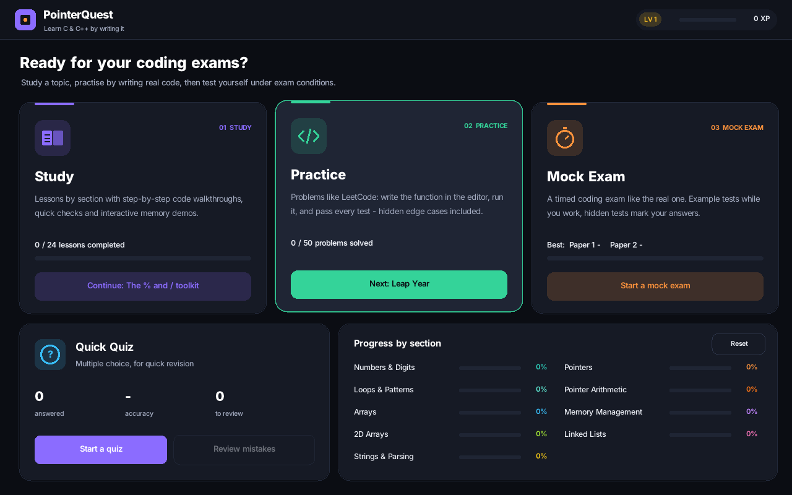
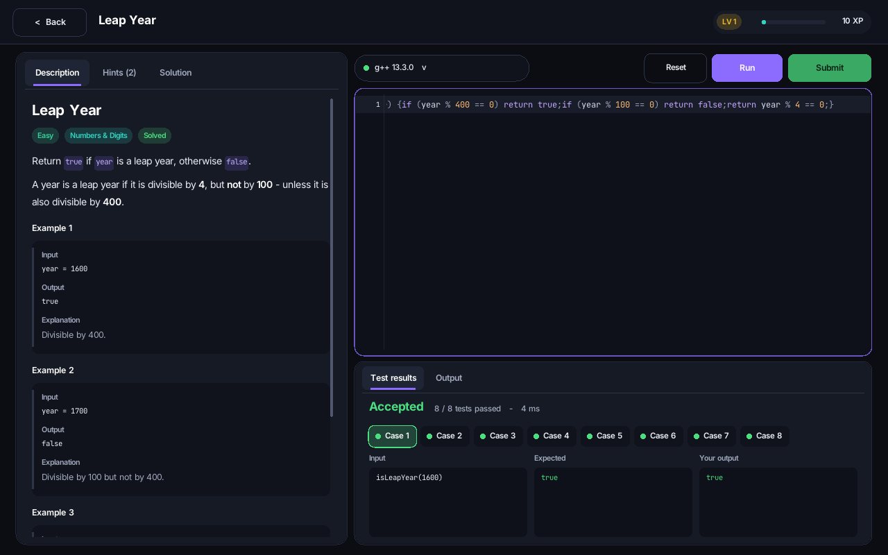
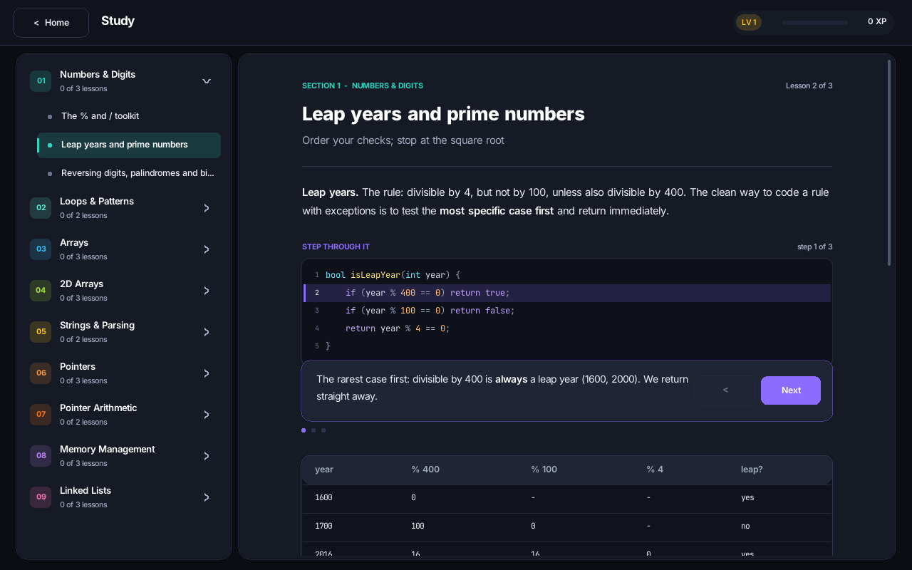
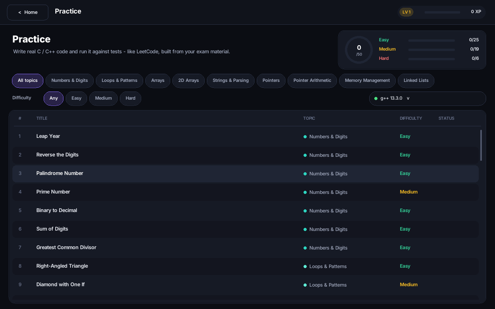
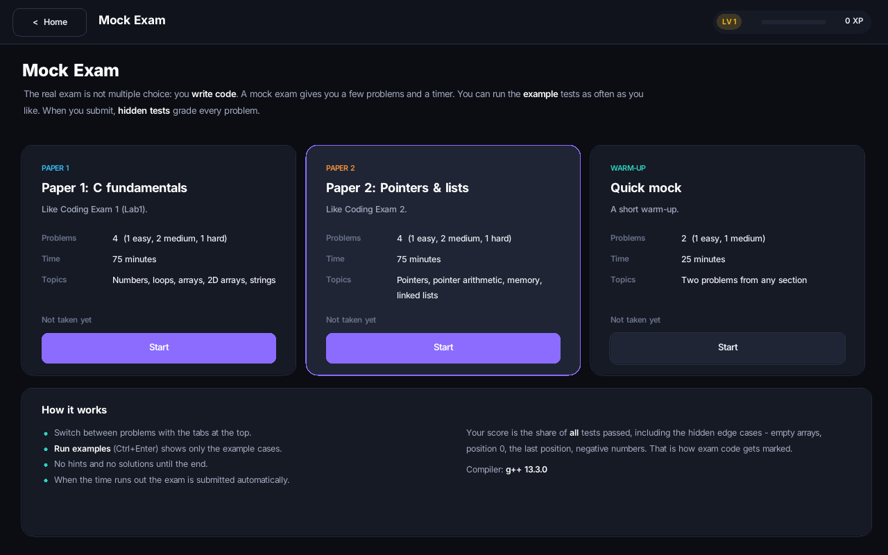
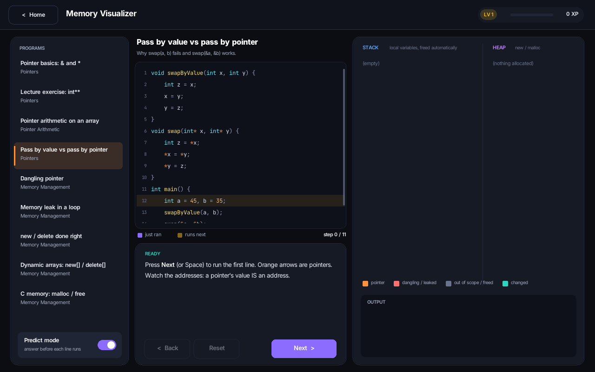
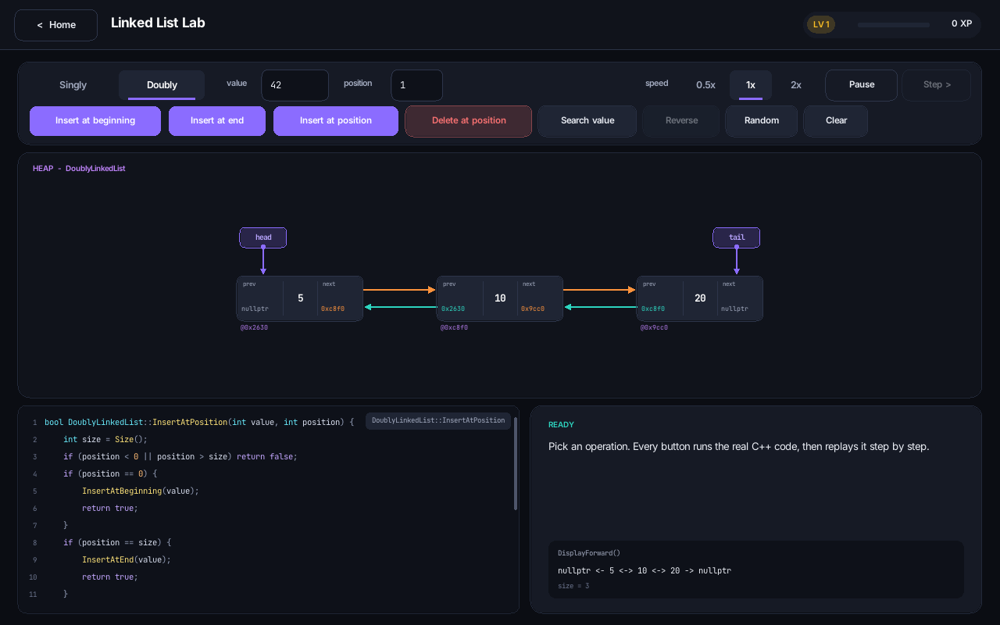

# SegFault - learn C & C++ by writing it

Segfault is a desktop app (C/C++17 + [raylib 5.5](https://www.raylib.com/)) for preparing the
**coding exams**: Lab1 (numbers, loops, arrays, 2D arrays, parsing C code) and Exam 2 (pointers,
pointer arithmetic, memory management, linked lists).

The exams are about **writing code**, so the app is too. It has three main parts and a quiz:

| | What you do |
|---|---|
| **Study** | 24 lessons in 9 sections. Each one explains an idea and has **step-through code walkthroughs**, tables, tips, common mistakes, quick checks, links to interactive demos (memory visualizer, linked list lab, grid) and the practice problems for that topic. |
| **Practice** | 50 problems, LeetCode style. Write the function in the built-in code editor, **Run** it against the example cases, then **Submit** to run every test, hidden edge cases included. Hints and the reference solution are available, and your code is saved automatically. The editor autocompletes as you type, like HackerRank: keywords, types, library functions and the names in your own code (Tab or Enter to accept, Ctrl+Space to ask for suggestions). |
| **Mock Exam** | A timed exam (Paper 1: C fundamentals, Paper 2: pointers & lists, or a quick 25-minute mock). You can run the example tests while you work. When you submit, hidden tests mark every problem and you get a score and a review against the reference solutions. |
| **Quick Quiz** | 68 multiple-choice questions for quick revision, with explanations and a list of mistakes to review. |



| | |
|---|---|
|  |  |
|  |  |
|  |  |

## Student accounts

The app opens with a short intro (the logo and a loading bar while it looks for a compiler;
any key skips it), then the login screen. Each student registers with a username and password, and their
XP, progress and saved code are kept separately, so several students can share one computer.
Accounts live next to the executable:

```
segfault_users/users.txt         username, salt and password hash (PBKDF2-HMAC-SHA256, 600,000 rounds),
                                 and the same for the recovery code
segfault_users/user_<name>/      that student's progress and saved code
```

Passwords are never stored. Accounts are local to the computer: they keep students' work apart,
but anyone with access to the folder can read or delete these files, and a forgotten password
can only be reset with the account's recovery code. Progress saved by an older version moves to the first
account created.

**Forgot password.** When an account is created the app shows a recovery code such as
`ABCD-EFGH-JKMN`, once. *Forgot password?* on the login screen takes the username, that code and
a new password. Each code works once: after a reset the student is given a new one. Accounts
made before recovery codes existed get a code the next time they log in.

## Themes

The **Theme** button in the top bar opens a picker with eight themes. Dark: Midnight (the
original), Catppuccin (Mocha), Nord, Dracula, Gruvbox and Everforest. Light: Paper and Latte
(Catppuccin). The community ones use the published colours of those palettes, which are
favourites in editor-theme discussions; a few colours are nudged where `--selftest` found them
too faint. The choice applies straight away and is saved to the student's account. The mouse
cursor (arrow, hand and text cursor) is drawn in the theme's colours too; it is a real system
cursor, so it moves without delay. A short trail in the theme's colours follows the mouse and
fades a fifth of a second after it stops; both the trail and the themed cursor can be switched
off in the theme window (restoring the standard system pointer). `--selftest` checks every theme's text and code colours for
contrast. Palettes live in `src/app/theme.cpp`.

## Profile

Click your picture on the home screen, or your name in the top bar. Choose a picture with the
*open file* window, drop one onto the window, or paste one with Ctrl+V (PNG, JPG, BMP or GIF, up
to 20 MB). It is cropped to a square from the middle and saved as `avatar.png` in the student's
folder. Without a picture, your initial is shown on the colour you pick. The profile also shows
your stats.

## Leaderboard

**Leaderboard** on the home screen ranks every student on this computer by XP, problems solved,
quiz accuracy or best mock exam, with the top three on a podium. It reads each student's
progress file, so it only includes students who use this computer.

## How your code is compiled

When you press Run, your code goes into a small test harness, gets compiled, and runs with a time
limit. Each test case prints one result line, and the app reads those lines back. Compiler errors
point at the line in **your** code. Infinite loops get *Time Limit Exceeded*, and crashes get
*Runtime Error*. The exam rules are checked too: "no array indexing" in the pointer problems, and
"no if" in the diamond pattern.

The app looks for a compiler at start-up, in this order:
1. `g++` or `clang++` in your PATH (MinGW / MSYS2 on Windows, Xcode tools on macOS, gcc on Linux)
2. **Visual Studio** (`cl.exe`, found with `vswhere`)
3. **TinyCC**, bundled with the Windows build. It is C only: 39 of the 50 problems work with it. The other 11 need C++ (references, classes, `new`) and ask for one of the compilers above.

If you have several compilers, click the compiler button to switch between them.

## Running it

- **Windows (ready-made):** extract `Segfault-Windows.zip` and double-click `Segfault.exe`.
- **Windows (from source):** double-click `run.bat`, or open the folder in Visual Studio 2022 (*File > Open > Folder*) and press F5.
- **macOS / Linux:** `./run.sh`

`run.bat` and `run.sh` run CMake for you. To do it by hand:
```
cmake -B build -DCMAKE_BUILD_TYPE=Release
cmake --build build --config Release
```
raylib is downloaded automatically the first time.

## Tests

```
./build/pq_tests                  # 141 unit tests of the reference solutions
./build/auth_tests                # student accounts: hashing against published test vectors,
                                  # register, login, bad input, what ends up on disk
./build/scrollbar_tests           # scrollbar geometry: thumb position and dragging
./build/paste_tests               # what a text box keeps from pasted text
./build/complete_tests            # editor autocompletion: what is suggested, and in what order
./build/avatar_tests              # profile pictures: crop, round mask, paths with non-ASCII letters
SEGFAULT_BENCH=1920x1080 ./build/Segfault --shot 0 - out.png 330   # frame times (add
                                  # SEGFAULT_BENCH_TOUR=1 to visit every screen)
./build/Segfault --selftest   # compiles every problem's reference solution with every compiler
                                  # found and checks that all tests pass and every starter fails;
                                  # also checks lesson links and the visualizer programs
```

## Project structure

```
src/solutions/   reference solutions (Lab1, the pointer functions, both linked lists): compiled
                 into a library used by the unit tests; Study and Practice show this same code
src/app/         main loop and scaling, UI toolkit (ui.cpp), code editor (editor.cpp),
                 student accounts (auth.cpp), compiler detection + test runner (runner.cpp), process launching with
                 time limits (process.cpp), progress and saved code (app.cpp)
src/content/     lessons.cpp, problems.cpp (statements, starter code, tests),
                 questions.cpp, mem_programs.cpp
src/scenes/      login, home, study, practice, mock, quiz, workspace (problem screen),
                 visualizer, listlab, grid (interactive demos)
third_party/     TinyCC for Windows (LGPL, see COPYING.txt)
resources/fonts  Inter + JetBrains Mono (SIL OFL)
```

Text is rendered at exactly the font's pixel size for the current window scale, and the
Windows/macOS builds are DPI-aware, so text stays sharp on any screen.

## Credits
raylib (zlib), TinyCC (LGPL 2.1), Inter and JetBrains Mono (SIL OFL 1.1).
Colour palettes: Catppuccin, Nord, Dracula, Gruvbox and Everforest (all MIT).
Content is based on the SETU module material: Lab1.cpp, the Coding Exam 2 brief, and the
"Pointers in C,C++" and "Memory Management" lecture notes.
